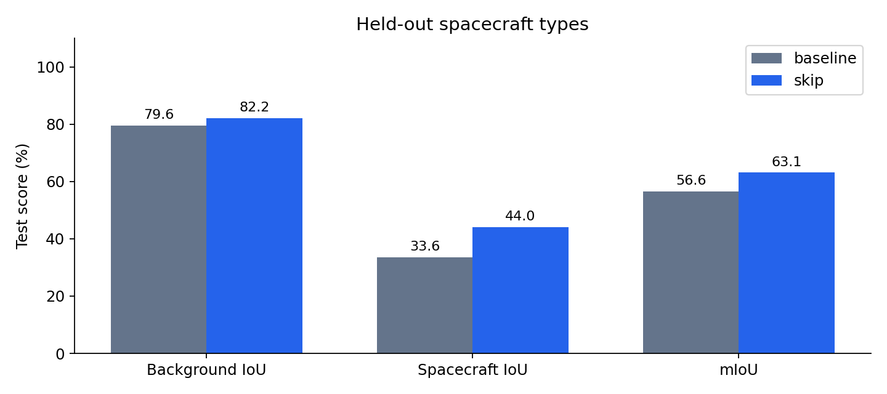
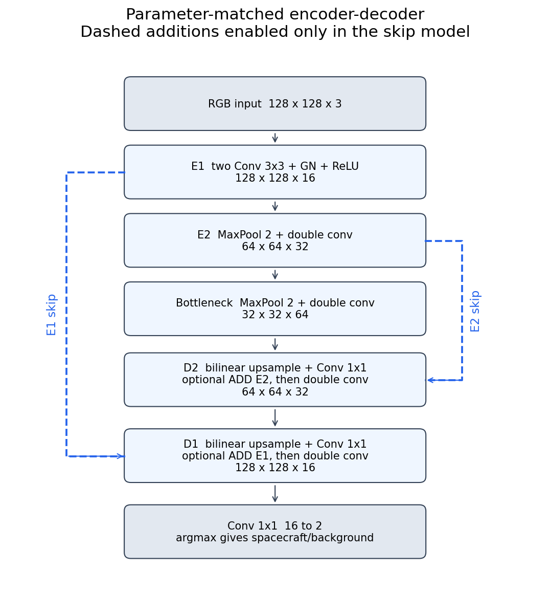
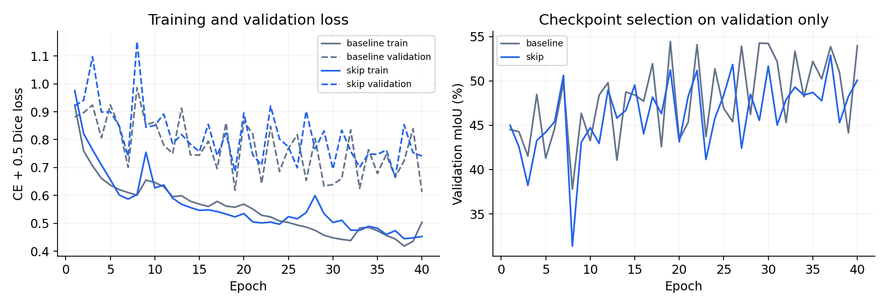
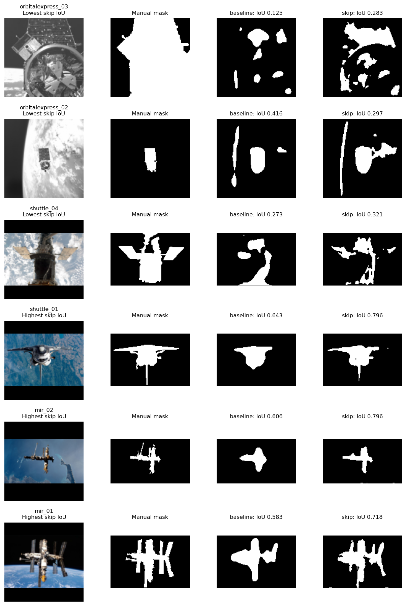
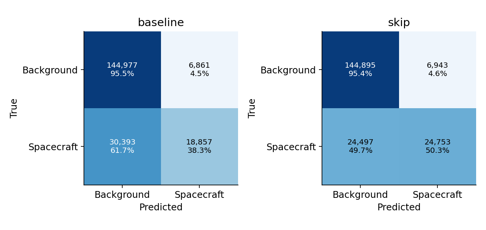

# Spacecraft Segmentation with Additive Skip Connections

A reproducible Advanced Computer Vision experiment on **100 SATSEG scenes**. Two small encoder-decoders differ only in whether additive encoder-to-decoder skips are enabled.

**Measured finding:** Enabling additive skips increased held-out test mIoU by 6.53 percentage points. The same trainable layers, initial weights and training settings were used. This single run does not establish that skip connections are generally better or worse.

## Results

| Model | Background IoU | Spacecraft IoU | mIoU | Dice | Parameters | Median latency |
|---|---:|---:|---:|---:|---:|---:|
| baseline | 79.56% | 33.61% | 56.58% | 50.31% | 98,178 | 8.86 ms |
| skip | 82.17% | 44.05% | 63.11% | 61.16% | 98,178 | 8.69 ms |


Measured on cpu with 2 CPU threads, batch 1, float32. Latency excludes preprocessing and transfer, and uses 20 warm-ups and 100 measurements. Full conditions: [metrics.json](results/metrics.json).



## Reproduce from scratch

Read [START_HERE.md](START_HERE.md) for Windows installation, folder instructions and GitHub upload. From this folder, with Python and dependencies installed:

```bash
python download_data.py
python sanity_check.py
python train.py --epochs 40 --seed 42 --threads 2
python evaluate.py --threads 2
python make_report.py
```

The downloader uses only Python standard-library networking. No Kaggle token is needed. Raw dataset files are excluded from Git. Existing results are overwritten when rerunning. PyTorch selects CUDA if available; use `--device cpu` to match this run. CPU/runtime variations can change timing and numerical results.

## Dataset contract

Official source: [SATSEG DOI](https://doi.org/10.5683/SP3/VDAN02), Shi and Ulrich. Licence: CC BY-NC-SA 4.0. This repository contains code and attributed result examples, not the full raw dataset. Author code is released under MIT in LICENSE; dataset-derived figures remain subject to the dataset licence.

- Exactly 100 colour scenes; grayscale duplicates are not used.
- Raw mask 0 becomes background 0; raw 255 becomes foreground 1.
- 128 x 128 aspect-preserving letterbox; bilinear photographs, nearest masks; pixels scaled to [0,1]. Padding is ignore ID 255 in training and evaluation.
- Custom split: **65 training, 19 validation, 16 test**. Whole spacecraft types are held out. Validation: Radarsat only. Exact IDs in `data/*.txt`; group definitions in `data.py`; checksums and dimensions in `data/audit.json`.
- This is not an official benchmark split and does not prove all source photos are independent.

## Architecture and controlled change



Channels 16, 32, 64 in the encoder; two 3x3 convolutions per block with four-group GroupNorm and ReLU. Two 2x2 pooling operations. Decoder uses bilinear upsampling, 1x1 channel projections, and double-convolution blocks. Final 1x1 layer emits two class logits. Skips add E2 to D2 and E1 to D1 before the decoder convolution blocks. Both models have **98,178 parameters**.

Identical initial state, seed, batches, augmentation sequence, loss and epoch budget. Loss = cross entropy + 0.5 foreground soft Dice, smoothing 1. Adam lr=0.001, default betas, no weight decay; batch 8; 40 epochs; seed 42; horizontal flip probability 0.5. Select the earliest checkpoint achieving maximum validation mIoU. No test-driven tuning.

## Training evidence



Per-epoch CSV logs, configuration, environment versions, selected checkpoints and metrics are included. Sanity checks verify known IoU, ignored pixels, identical initial states and tiny-data learning.

## Successes and failures



First three: lowest skip-model foreground IoU. Last three: highest. Scene IDs identify source images. All test cases are available in `results/per_image_metrics.csv`.



## Interpretation

Spacecraft recall: baseline 38.29%, skip 50.26%. Precision: baseline 73.32%, skip 78.10%. For shuttle_01, spacecraft IoU changed from 0.643 to 0.796. For orbitalexpress_02, it changed from 0.416 to 0.297. These individual examples show why aggregate scores should be accompanied by per-image analysis. Visual changes in outlines are not a separate boundary-accuracy measurement. The Radarsat-only validation set limits interpretation of checkpoint ranking. Small median latency differences in this short benchmark do not establish a speed advantage.

## Metrics and limitations

IoU = TP/(TP+FP+FN), computed after accumulating all valid test pixels. mIoU averages foreground and background IoU. Reported Dice, precision, recall and accuracy are secondary. Padding never contributes to metrics. Both models use argmax, with no postprocessing.

One seed, 16 test images, a Radarsat-only validation set and low-resolution inputs limit inference. Type-held-out evaluation is demanding and differs from an image-random split. We do not infer universal architectural superiority, flight readiness, improved docking or pose accuracy. Parameter equality does not imply equal latency. Related-photo leakage may remain despite type separation.

## Deliverables

- [Step-by-step setup and submission](START_HERE.md)
- [Offline visual dashboard](results/dashboard.html) — download and open in a browser
- [Comparison](results/comparison.csv)
- [Exact evaluation and latency protocol](results/metrics.json)
- [All test-image scores](results/per_image_metrics.csv)

## References

1. Shi and Ulrich. SATSEG dataset. https://doi.org/10.5683/SP3/VDAN02.
2. Ronneberger et al. U-Net, MICCAI 2015. https://arxiv.org/abs/1505.04597. Our model uses additive rather than original U-Net concatenative skips.
